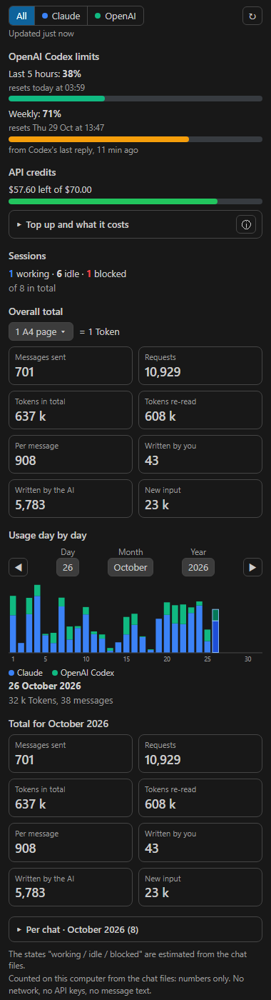

# Usage Panel for AI coding tools

A side panel for **VS Code, Cursor, Windsurf** (and any editor that installs VS Code extensions) that shows how much you use your AI coding assistants — **Claude Code, OpenAI Codex, Gemini CLI, Qwen Code, Kimi CLI, ZCode (GLM), MiniMax Code, opencode, Kilo Code, Cline, Roo Code, Continue and Aider** — whatever model they use (Claude, GPT, Gemini, DeepSeek, Qwen, Kimi, GLM, MiniMax, Grok…).

- **Adapts to your tools by itself**: it looks for the files of every supported tool on your computer and shows only what it finds. With one tool the panel is just for that one; with more, a selector at the top lets you see each tool or **All** together. Every tool can be switched off in the settings
- **Totals**: messages sent, requests, tokens (total, re-read from cache, written by the AI, written by you, new input), tokens per message. Click a box for its explanation
- **Readable token unit**: choose what 1 Token equals — one A4 page, one book, one hour of writing, or one real token
- **Daily bar chart** for the chosen month, with day / month / year choosers (one color per tool when "All" is selected), and the totals of that month
- **Usage per chat** for the chosen month, grouped by day, with tool, project, model and last activity
- **Sessions**: working, idle or blocked by a limit
- **Limits** reported by the tools themselves (OpenAI Codex: 5-hour and weekly window)
- **API credits and prices**: a **Top up and what it costs** box with the official API prices of Anthropic, OpenAI, Google, DeepSeek, Alibaba (Qwen), Moonshot (Kimi), Z.ai (GLM), MiniMax and xAI, read on their pricing pages on 26 October 2026, with links to those pages. Behind the small **ⓘ** icon: what today and this month would cost at API prices, and — if you write your own credits file — credit left, expiry dates and jobs done
- **Model choice (model routing)**: for every tool found, the cheap / middle / flagship model of its provider with prices, what each level is for, an estimate of what you would save this month compared with always using the flagship, and a **Try it** box: describe a job and the panel tells you at once which level and model to use, and why. See [Model choice](#model-choice)



*Screenshot with invented data.*

## Supported tools

| Tool | Files read (numbers only) | Format checked |
|---|---|---|
| Claude Code | `~/.claude/projects/**/*.jsonl` | on real files |
| OpenAI Codex CLI | `~/.codex/sessions/**/rollout-*.jsonl(.zst)`, `archived_sessions/`, `session_index.jsonl` | official source code ([openai/codex](https://github.com/openai/codex)) |
| Gemini CLI | `~/.gemini/tmp/*/chats/*.jsonl` (and older `session-*.json`), `.project_root` | official source code ([google-gemini/gemini-cli](https://github.com/google-gemini/gemini-cli)) |
| Qwen Code | `~/.qwen/projects/*/chats/<session>.jsonl` (also `chats/archive/`, older `tmp/*/chats/`) | official source code ([QwenLM/qwen-code](https://github.com/QwenLM/qwen-code)) |
| Kimi CLI (Moonshot) | `~/.kimi/sessions/*/*/wire.jsonl` (+ subagents), `kimi.json`, `config.toml` (`default_model`), `state.json` (title). `credentials/` is never opened | official source code ([MoonshotAI/kimi-cli](https://github.com/MoonshotAI/kimi-cli)) |
| ZCode (Z.ai, GLM) | `~/.zcode/cli/db/db.sqlite` (tables `model_usage`, `session`), read-only | official source code ([zai-org/ZCode](https://github.com/zai-org/ZCode)) |
| MiniMax Code | `~/.minimax/v2/sqlite/*.sqlite` (table `local_runtime_token_usage`), read-only | official source code ([MiniMax-AI/minimax-code](https://github.com/MiniMax-AI/minimax-code)) |
| opencode | `~/.local/share/opencode/opencode.db` (tables `session`, `message` / `session_message`), read-only; older `storage/` JSON files | official source code ([anomalyco/opencode](https://github.com/anomalyco/opencode)) |
| Kilo Code | `~/.local/share/kilo/kilo.db` (same tables as opencode), read-only | official source code ([Kilo-Org/kilocode](https://github.com/Kilo-Org/kilocode)) |
| Cline | `<editor>/User/globalStorage/saoudrizwan.claude-dev/tasks/*/ui_messages.json`, `state/taskHistory.json` (folder only); Cline CLI: `~/.cline/data/sessions/*/*.messages.json` | official source code ([cline/cline](https://github.com/cline/cline)) |
| Roo Code | `<editor>/User/globalStorage/rooveterinaryinc.roo-cline/tasks/*/ui_messages.json`, `history_item.json` (folder only) | official source code ([RooCodeInc/Roo-Code](https://github.com/RooCodeInc/Roo-Code)) |
| Continue | `~/.continue/dev_data/0.2.0/tokensGenerated.jsonl` | official source code ([continuedev/continue](https://github.com/continuedev/continue)) |
| Aider | `.aider.chat.history.md` in the open project folders (and the ones in the `folders` setting) | official source code ([Aider-AI/aider](https://github.com/Aider-AI/aider)) |

**Only Claude Code was tried on real files.** The other readers were written from the tools' official source code (checked on 26 October 2026) and tested with invented files in those formats; if a tool changes its format, please open an issue.
`<editor>` is the data folder of VS Code, Cursor, Windsurf, VSCodium, Trae or Kiro, so Cline and Roo Code are found in all of them.
DeepSeek has no official coding tool of its own: DeepSeek models are counted wherever you use them (opencode, Cline, Kilo Code, Aider, Continue, Claude Code with an Anthropic-compatible endpoint…). The same goes for GLM, Kimi, Qwen and MiniMax models used through other tools.

Notes on the numbers: Continue counts tokens with its own tokenizer and has no cache figures; Roo Code does not save the model name; Kimi CLI saves only the default model; ZCode keeps its usage for 30 days.
opencode, Kilo Code, ZCode and MiniMax Code need an editor whose Node.js includes `node:sqlite`; otherwise the panel says so.

## Privacy

Everything is counted **on your computer** from the files that the tools already write.
Only numbers are kept: token counts, dates, message counts, chat titles, project folder names and model names.
**Message text is never stored or shown**: some of these files contain the chat text, which is read in memory to get the numbers and then dropped (only its length is used to estimate "tokens written by you").
The extension makes **no network requests**, **never reads or asks for an API key**, reads no environment variables and is not connected to any account. Databases are opened read-only.
The only pages it can open are the official price and billing pages listed in `src/prezzi.js`, in your browser, when you click their link.
A small cache with the numbers is kept in the editor's extension storage so that, after the first time, only new lines are read.

## Install

### From a `.vsix` file (VS Code, Cursor, Windsurf)

1. Download `pannello-utilizzo-1.2.0.vsix` from the [Releases](https://github.com/y05mueller-jpg/claude-code-pannello-utilizzo/releases) page.
2. Install it:
   - **VS Code**: Extensions view (`Ctrl+Shift+X`) → `…` menu → **Install from VSIX…**, or run `code --install-extension pannello-utilizzo-1.2.0.vsix`
   - **Cursor**: Extensions view → `…` menu → **Install from VSIX…** (or drag the file onto the Extensions view), or run `cursor --install-extension pannello-utilizzo-1.2.0.vsix`
   - **Windsurf**: Extensions view → `…` menu → **Install from VSIX…**, or run `windsurf --install-extension pannello-utilizzo-1.2.0.vsix`
3. Click the **bar-chart icon** in the activity bar (or run **Usage Panel: Open** from the Command Palette).

### Build it yourself

From the `vscode` folder of this repository:

```
npm install
npm test
npm run package
```

No runtime dependencies: the extension is plain JavaScript.

## Settings

| Setting | Default | |
|---|---|---|
| `pannelloUtilizzo.sources.<tool>` | `true` | Count that tool: `claude`, `codex`, `gemini`, `qwen`, `kimi`, `zcode`, `minimax`, `opencode`, `kilo`, `cline`, `roo`, `continue`, `aider` |
| `pannelloUtilizzo.folders` | `{}` | Custom folders per tool, e.g. `{ "codex": "D:/codex-home", "aider": "C:/work/app1;C:/work/app2" }` (use it if you set `CODEX_HOME`, `GEMINI_CLI_HOME`, `QWEN_HOME`, `KIMI_SHARE_DIR` and similar) |
| `pannelloUtilizzo.apiCredits.enabled` | `true` | Show the API credits and prices section |
| `pannelloUtilizzo.apiCredits.configFile` | `~/.claude/utilizzo-api/config.json` | Your own API credits file |
| `pannelloUtilizzo.refreshSeconds` | `60` | How often to count again while the panel is visible |
| `pannelloUtilizzo.language` | `auto` | English, Italian, German, French or Spanish; `auto` follows the editor |

## API credits (optional file)

Without a file the section still shows the official prices and what your usage would cost at API prices.
To track your own credits, create the configuration file (start from [`config-api.example.json`](config-api.example.json)) with your credits, expiry dates and, if you want, your own prices per million tokens (they win over the official ones).
Add `"fornitore": "openai"` (or `google`, `deepseek`, `alibaba`, `moonshot`, `zhipu`, `minimax`, `xai`) to a credit to tie it to a provider; the default is `anthropic`.
Optionally, any tool of yours can append one line per job to `uso.jsonl` in the same folder (`{ "data", "titolo", "modello", "costo" }`) to show spending.
The panel never reads or needs an API key.

## Model choice

Cheap models for simple jobs, expensive ones for complex jobs. The rules are the same as in the Claude Code panel (`src/scelta.js`):

| Level | Model | When |
|---|---|---|
| **Light** | the provider's cheapest | short jobs (under 600 characters) to search, find, list, read, summarize, count, rename, translate, format, check logs or status. Keywords (it/en): *cerca, trova, elenca, leggi, riassum, conta/contare/contami, rinomin, tradu, formatt, log, stato, search, find, list, read, summar, count, rename, translat, format, status* |
| **Heavy** | the provider's flagship | design and planning, 3D, Blender, render, modelling, sites, backend, frontend, new apps, from scratch, refactor, migrations, security, hard debugging, optimization. Keywords: *progett, architettur, design, 3d, blender, render, modell, sito, backend, frontend, app nuova, da zero, refactor, migra, sicurezza, debug difficile, ottimizz, plan, architect, build, from scratch, website, security, migrate*. Also any job longer than 1500 characters. Heavy wins over the other levels |
| **Medium** | a model in between | everything else |

Models per provider come from the price list in `src/prezzi.js`: the cheapest, the one closest to the middle and the most expensive (aliases at the same price are skipped; with two models, light and medium share the cheaper one). Fixed choices where the list also has older or special models: Anthropic **Haiku / Sonnet / Opus 5.5**, OpenAI **gpt-6-luna / gpt-6.1-sol / gpt-6-astra**, Google **gemini-3.5-flash-lite / gemini-3.8-flash / gemini-4-argon**. Tools that can use any provider (opencode, Cline, Kilo Code, Roo Code, Continue, Aider) get the provider of the models they used most.

The savings line is an **estimate** at API prices on the tokens counted this month, assuming about **40% light, 40% medium and 20% heavy** jobs.
The **Try it** box works entirely in the panel: the text is not saved, not sent to the extension and never leaves the computer.

The panel recommends the model; in the tools that allow it (Claude Code with subagents, the API helper) the choice is automatic, in the others you set the model in the tool. The only model option documented in this extension is Kimi CLI's `default_model` in `~/.kimi/config.toml`.

## How the numbers are counted

- **Requests** are model replies; repeated lines of the same reply are counted once (by request id, message id or response id).
- **Tokens** = new input + output (reasoning included) + cache write + cache read. Tools that report input *including* the cache (Codex, Gemini, Qwen, Roo Code) are converted so that cache reads are shown apart.
- **Cost estimates** match the model name of each chat with your prices first, then the official price list (exact name, or the longest known name it starts with). Chats whose model has no known price are not counted and the panel says how many. Discounts (off-peak hours, batch) and long-context tiers are not applied.
- **Working / idle / blocked** are estimated from the files: working = written in the last 2 minutes; blocked = the last reply was a limit error (Claude Code) or a limit window at 100% (Codex).

The same panel also exists as a mod inside the Claude Code desktop app, in the [`utilizzo`](../utilizzo) folder of this repository.

Created by **Yannis Müller**, Founder of YouppyApps (y05mueller-jpg, y05.mueller@gmail.com), first published on 26 October 2026.

## Credit request

**If Anthropic, OpenAI, or anyone else, builds this panel or a feature based on it into their products,
please credit the author (y05mueller-jpg, y05.mueller@gmail.com) explicitly before publishing it.**
Copies and modified versions of this code must keep the copyright notice (MIT License).

---

### In italiano

Pannello laterale per VS Code, Cursor e Windsurf con messaggi, token, grafico giornaliero e utilizzo per chat di **Claude Code, OpenAI Codex, Gemini CLI, Qwen Code, Kimi CLI, ZCode (GLM), MiniMax Code, opencode, Kilo Code, Cline, Roo Code, Continue e Aider**, con qualsiasi modello (anche DeepSeek, Qwen, Kimi, GLM, MiniMax). Si adatta da solo: mostra solo gli strumenti che trova sul computer; se ce n'è più di uno, in alto si sceglie quale vedere o tutti insieme. La sezione «Scelta del modello» consiglia per ogni strumento il modello leggero, medio o di punta del suo fornitore, con i prezzi, una stima del risparmio del mese (supponendo 40% lavori leggeri, 40% medi e 20% pesanti) e una casella «Prova: descrivi il lavoro» che dice subito livello, modello e motivo, tutto in locale. Il box «Ricarica e quanto costa» ha i prezzi ufficiali di tutti i fornitori, letti il 26 ottobre 2026, con i dettagli dietro l'icona ⓘ.
Tutto viene contato sul tuo computer dai file che gli strumenti scrivono già: solo numeri, niente testo dei messaggi, niente rete, nessuna chiave API. Solo il lettore di Claude Code è stato provato su file veri; gli altri sono scritti dal codice sorgente ufficiale e provati con file inventati. Lingue: italiano, inglese, tedesco, francese, spagnolo.

Creato da **Yannis Müller**, Fondatore di YouppyApps (y05mueller-jpg, y05.mueller@gmail.com), pubblicato per la prima volta il 26 ottobre 2026.
**Se Anthropic, OpenAI o altri integrano questo pannello, o una funzione basata su di esso, nei loro prodotti, chiedo di citare esplicitamente l'autore prima della pubblicazione.**
